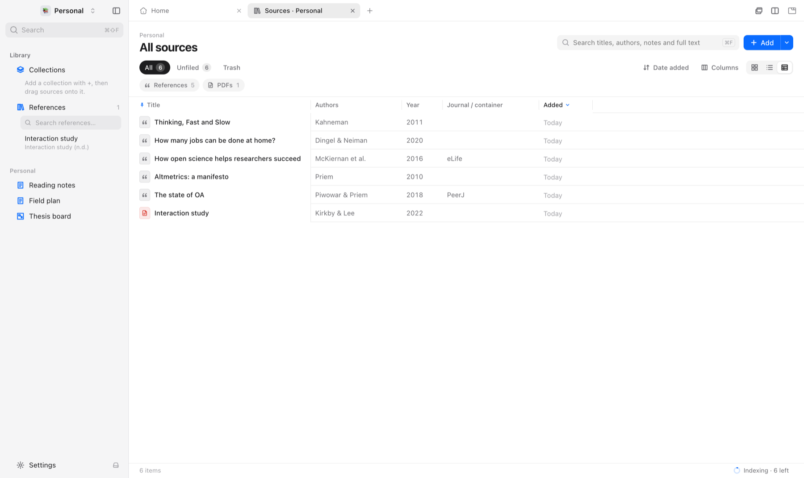
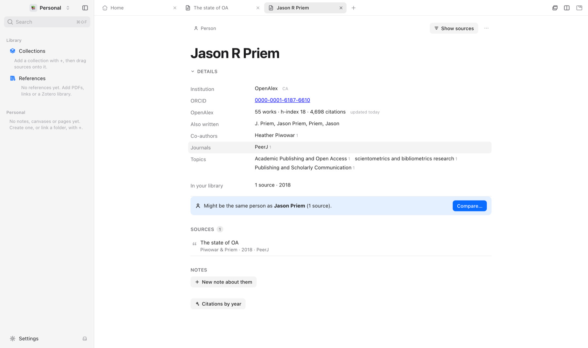
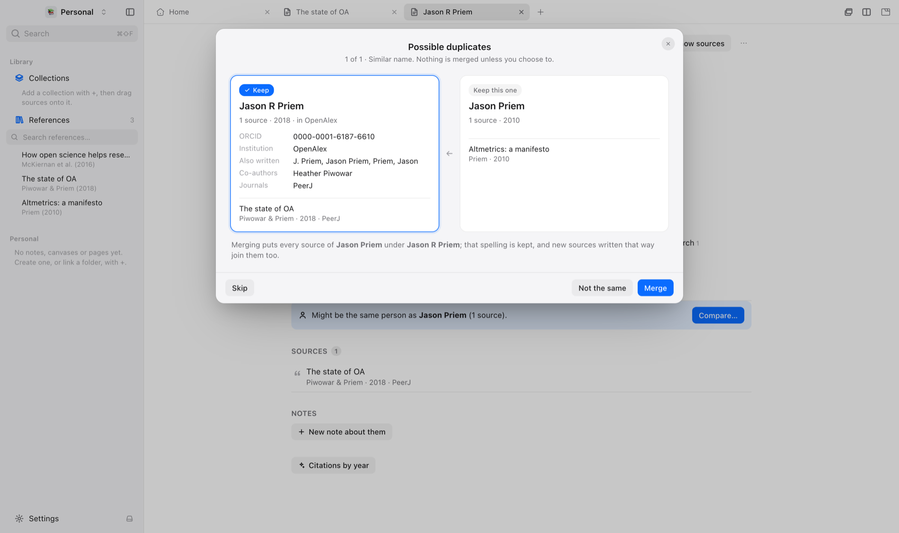
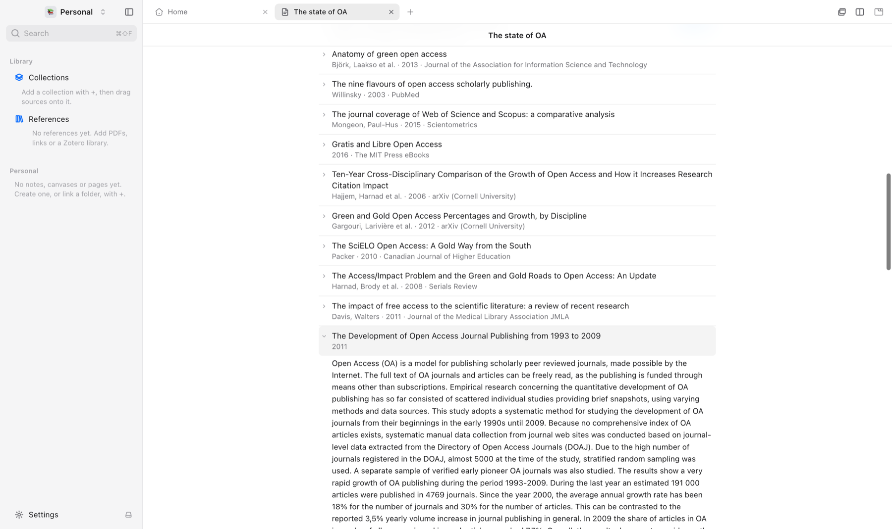
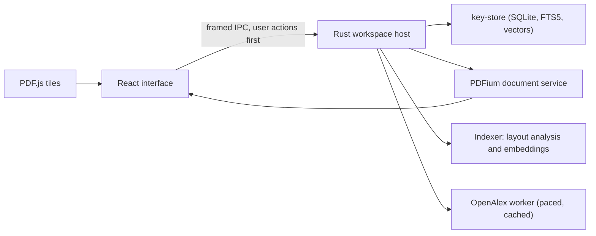

<p align="center">
  
</p>

<p align="center">
  <strong>A research workspace for macOS: read, annotate, search and connect the literature you work with.</strong>
</p>

<p align="center">
  Your PDFs, references, notes and canvases in one library on your Mac, searchable by words and by meaning,<br/>
  with the people, journals, topics and citations around every paper.
</p>

<p align="center">
  <a href="#what-key-does">What it does</a> ·
  <a href="#getting-started">Getting started</a> ·
  <a href="#how-it-works">How it works</a> ·
  <a href="#development">Development</a> ·
  <a href="#repository-map">Repository</a>
</p>

<p align="center">
  
  
  
  <a href="LICENSE"></a>
</p>

<p align="center">
  
</p>

> Key is under active development. The macOS build is an unsigned development build for contributors and testers, not a notarized release.

## What Key does

### A library that knows what is in it

- **Sources of every kind.** PDFs, web pages, references, books, video, audio and images live in one library per workspace, as a table, list or grid. Each has a page of its own: its details, its highlights and your notes about it.
- **Collections, tags and your own properties.** Typed properties (text, numbers, choices, formulas) work across the library. Renaming a choice renames it on every source.
- **Zotero.** Import a Zotero library once, or keep it in step with Zotero as it changes.
- **Linked folders.** Folders elsewhere on your Mac join the workspace without copying, and are watched and indexed.

### Metadata from OpenAlex

Sources with a DOI, PMID or OpenAlex id are looked up in [OpenAlex](https://openalex.org) in the background:

- **Stored and filterable:** authors with ORCID and their institutions at the time, the journal and publisher, topics (domain → field → subfield → topic), keywords, funders and grants, the work type, language, open-access status and link, and a prominent warning when a work has been retracted.
- **Cached and refreshed when you look:** citation counts and FWCI, and a person's works count and h-index.
- **Fetched on demand:** citations by year, related works, and the abstract of any cited work.

People, journals and topics become pages of their own. Click a name on a source for a short summary first (what your library holds of them), then filter the library by them or open their page: their sources, co-authors, journals and topics, and the notes you wrote about them. Each source lists what it cites; works already in your library are linked both ways, and the others open in place to their abstract and can be added with one click.

People are merged automatically only when an ORCID or OpenAlex id says they are one person. Name variants are only suggested, and you compare them side by side before deciding.

<table>
<tr>
<td width="50%"></td>
<td width="50%"></td>
</tr>
<tr>
<td valign="top"><strong>People, journals and topics</strong><br/>Everything the library connects to a person, with counts that stay current.</td>
<td valign="top"><strong>Duplicates, decided by you</strong><br/>Both people side by side, with a few of their sources, before anything is merged.</td>
</tr>
</table>

### Reading

- **A fast PDF reader.** PDF.js draws the pages; a native Rust service with PDFium supplies the exact text, its geometry, search, outlines and links. Highlights and comments are anchored to the text itself, so they survive zoom, re-rendering and reopening.
- **A structure rail** on the reader's edge shows the chapters (from the PDF's outline, or from the headings layout analysis found) or page thumbnails, with your highlights and search hits marked.
- **Layout analysis** (an on-device model) recovers reading order, headings, tables and the bibliography. In-text citations show what they cite, and references to papers in your library become links.
- Tabs, splits, several windows, and a reader beside each source's page.

<p align="center">
  
</p>

### Notes, pages and canvases

- **Notes** are Markdown with blocks, quotes from your highlights, media, and `@` links to any source, highlight, person, journal, note or canvas. Backlinks show where each item is mentioned.
- **Every item is a page** with the same quiet layout: a title that stays pinned while you scroll, and its details folded beneath it.
- **Canvases** lay out sources, notes and highlights as cards with connectors.
- Docs, Sheets, Slides, Markdown and HTML editors are part of the same workspace.

### Search

- **One search for everything.** Titles and details, the full text of every PDF and note, and passages related by meaning. Matches are grouped by item, and open beside the results with a bar to step through them.
- **Filters as tokens**, Apple Mail style: authors, journals, topics, keywords, funders, tags, collections, years, properties, open-access status, and citation counts ("cited >100").
- **On-device semantic search.** EmbeddingGemma runs on your Mac through llama.cpp. Your files, notes and searches stay on your Mac. Only identifiers are sent to OpenAlex, and that lookup can be turned off in Settings.

## Getting started

Requirements: macOS on Apple silicon, Xcode Command Line Tools, a current stable Rust toolchain, and Node.js 22.12 or newer.

```sh
cd apps/key-office
npm install
npm run build:backend -w @key/electron   # the Rust host (PDFium, search, the library)
npm run build:all                        # the editors and the Key shell
npm run start -w @key/electron
```

To build `Key.app` (unsigned, in `apps/key-office/apps/key/release/mac-arm64/`):

```sh
npm run dist:mac -w @key/electron
```

See the [packaging notes](apps/key-office/apps/key/PACKAGING.md) for what the app bundles and how it is put together.

Workspaces live in `~/Documents/Key` by default; each is a folder with its own library database. In Settings you can turn the layout model and OpenAlex lookups on or off, give OpenAlex a contact email or API key, and review possible duplicate people.

## How it works

| Layer | Responsibility | Technology |
|----|----|----|
| Desktop shell | Windows, tabs and splits, menus, settings, one host process per workspace | Electron |
| Interface | Library, pages, notes, canvases, search, reader chrome | React, TypeScript |
| Page rendering | Visible pages as bounded tiles | PDF.js |
| Workspace host | Library commands, imports, indexing, analysis, OpenAlex enrichment | Rust (`key-desktop-host`) |
| Library store | Sources, people, venues, topics, citations, notes, links; keyword and vector search | SQLite with FTS5 and sqlite-vec (`key-store`) |
| Document services | Canonical text and geometry, search, outlines, links | PDFium (`key-pdfium`, `key-pdf-runtime`) |
| Layout and embeddings | Reading order, headings, tables, references; passage vectors | ONNX layout model, EmbeddingGemma via llama.cpp |
| Scholarly metadata | OpenAlex works and authors, Crossref and Semantic Scholar lookups | `key-reference`, `key-safe-http` |



- **Text identity.** PDFium character order is the durable identity of a passage. Highlights store character ranges and canonical geometry, not screen pixels or PDF.js text items, so the same anchor resolves at any zoom and in any pane.
- **Background work never blocks you.** Indexing, analysis and OpenAlex lookups run in the background and are paced. Requests from the interface are ordered so that whatever you just did goes ahead of polls and refreshes, and is never refused for being one too many.
- **The metadata graph.** A source keeps the text it shows and cites (its authors as written, its journal title). Separate tables say who and what that text is: people, venues, publishers, institutions, topics, keywords and funders, linked to sources by id. See `crates/key-store/src/graph.rs` and `openalex.rs`.

## Development

From `apps/key-office/apps/key`:

| Task | Command |
|----|----|
| Type check | `npx tsc --noEmit -p .` |
| Unit tests | `npx vitest run` |
| Build the interface | `npm run build` |
| Build the Rust host | `node scripts/build-backend.mjs` |
| End-to-end checks | `node scripts/smoke-<name>.cjs` (after `npm run build`), e.g. `smoke-library`, `smoke-source-page`, `smoke-search`, `smoke-openalex`, `smoke-pdf` |
| Library store tests | `cargo test -p key-store` (from the repository root) |

The smokes drive the real app with Playwright on temporary profiles. OpenAlex is never contacted in tests: `KEY_OPENALEX_FIXTURES` points the host at recorded responses in `tests/fixtures/openalex`.

Interface colours come only from theme tokens; see [`apps/key-office/CLAUDE.md`](apps/key-office/CLAUDE.md) for the rules, which CI checks.

## Repository map

| Path | Purpose |
|----|----|
| [`apps/key-office/apps/key`](apps/key-office/apps/key/) | The Key app: Electron main process, React interface, smokes |
| [`apps/key-office`](apps/key-office/) | The workspace it builds in, with the Docs, Sheets, Slides, Markdown and HTML editors |
| [`apps/key`](apps/key/) | The PDF reader package (PDF.js workspace) and the earlier Tauri shell |
| [`crates/key-desktop-host`](crates/key-desktop-host/) | The per-workspace host process |
| [`crates/key-store`](crates/key-store/) | The library database: sources, metadata graph, notes, links, search |
| [`crates`](crates/) | PDFium services, indexing, embeddings, Zotero import and the shared runtime |
| [`extensions/key-reference`](extensions/key-reference/) | Scholarly metadata providers and scheduling |
| [`experiments/gpui-pdf-reader`](experiments/gpui-pdf-reader/) | A frozen native GPUI reader, kept as a reference |
| [`tests`](tests/) | Shared fixtures (PDFs, recorded OpenAlex responses) |

### Further reading

| Document | Covers |
|----|----|
| [Reader package](apps/key/README.md) | The PDF.js workspace, benchmarks and renderer entry points |
| [Engine boundary](apps/key/docs/engine-contract.md) | Commands and data between the interface and the PDF services |
| [Text and coordinates](notes/text-layer.md) | Canonical character order, bounds, hit testing |
| [Scheduling and zoom](notes/scheduling-and-zoom.md) | Rendering budgets, cancellation and interaction |
| [Links and scientific references](notes/links-and-scientific-references.md) | Citation detection, lookup and previews |
| [Testing](notes/testing.md) | Fixtures, deterministic checks and end-to-end coverage |
| [Extensions](extensions/README.md) | Capability-based extension contracts |

## Current limitations

- macOS on Apple silicon is the only validated platform; the build is unsigned.
- Password-protected PDFs have no password prompt yet, and PDF forms are not supported.
- OpenAlex data depends on OpenAlex's coverage and limits; without an API key, requests share a small daily budget per network.

## Feedback

Reports are most useful with a reproducible PDF, what you expected and what happened. [Open an issue](https://github.com/JonasWeinert/Key-KMP/issues).

## License

Key is MIT licensed. See [LICENSE](LICENSE), [THIRD_PARTY_NOTICES.md](THIRD_PARTY_NOTICES.md) and the [PDFium notices](vendor/pdfium/licenses/).
