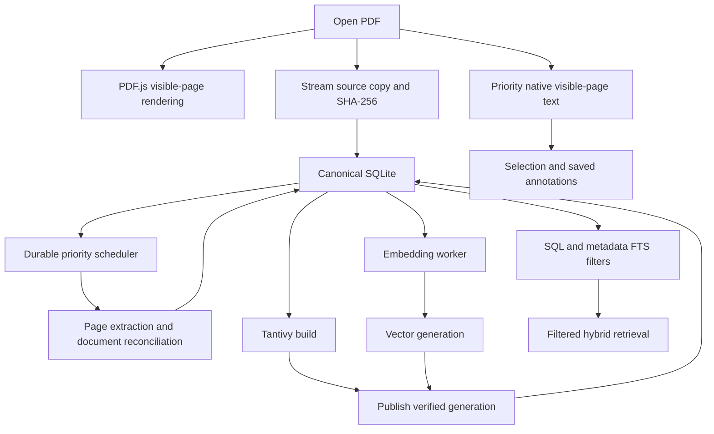

# Plan: Canonical library and processing scheduler

Status: implementation underway; see [implementation status and remaining gates](canonical-library-implementation-status.md). Implements the [PRD](canonical-library-prd.md). Date: 2026-09-10.

## 1. Components and ownership

Introduce `key-library` for the SQLite repository, migrations, source/artifact identities and canonical records. Introduce `key-processing` for durable jobs, priority scheduling and worker supervision. Keep `key-semantic-search` responsible for embedding and retrieval adapters; it receives canonical chunk/text readers instead of owning a second JSON library.

Tauri composes these services and exposes document IDs, paged data, search and progress. React owns presentation. PDF.js remains the renderer; PDFium remains the reader's character/geometry authority. Preserve PDFium handle ownership on its owner thread or in a helper process; do not move native handles across threads to achieve concurrency.

Use `rusqlite` with bundled conventional SQLite/FTS5, WAL, foreign keys, a busy timeout and explicit migrations. Start with one bounded writer queue and independent short-lived/read-pool transactions. User saves and interactive state updates outrank processing writes. Use durable commit settings for annotations; benchmark batch size rather than weakening save semantics. Never hold a database transaction over PDF extraction, HTTP, embeddings or index construction.



## 2. Canonical schema outline

This is a logical schema, to be turned into numbered migrations in Phase 1. Use compact integer internal keys; keep stable external hashes/IDs unique and indexed. Store SHA-256 as 32-byte BLOBs, rendering hex only at boundaries.

| Tables | Required fields and purpose |
|---|---|
| `documents`, `document_sources` | Unique PDF hash, byte size, page count, managed blob locator, source paths, import state, deletion state and timestamps |
| `bibliographic_records`, `authors`, `document_authors` | Resolved title/year/DOI/venue, ordered authors, explicit user overrides; indexes for filters |
| `metadata_observations` | Field, typed value/raw response, provider, retrieval time, provenance and selected-value relationship |
| `property_definitions`, `document_properties`, tags/collections joins | Typed extensible values; indexes by property/type/value/document; explicit NULL/missing rules |
| `extraction_runs`, `pages`, `blocks`, `sentences` | PDF hash, extraction identity/status, ordered hierarchy, text ranges, block kinds, ready/staged state |
| `page_payloads` | Canonical page/block text and separate versioned binary geometry payloads; checksums and codecs |
| `annotations`, `annotation_anchors`, `comments` | Stable UUIDs, PDF hash, extraction/anchor version, page/character ranges, quote context, color, text and timestamps |
| `references`, `citations`, `document_links` | Local reference identities, resolved works, source/target anchors, relationship and provenance |
| `chunks` | Stable ID, extraction/chunking identity, target/context offsets, sentence/block/page mapping and content hash; no repeated context text |
| `artifacts`, `embedding_cache` | Producer identity, checksums, location or packed BLOB, validity state, vector dimension/dtype and byte count |
| `jobs`, `job_checkpoints` | Unique work key, document/stage, dependency, priority, lease, attempt, durable counts, error and checkpoint |
| `index_generations`, `index_membership`, `publication_outbox` | Per-document lexical/vector readiness, compatible corpus identity, generation paths/checksums and canonical record mappings |
| `legacy_imports`, `key_schema_migrations` | Idempotent legacy record receipts, unresolved payloads and Key-owned migrations |

FTS5 virtual tables index resolved metadata text and comments, linked to canonical row IDs. Update them in the same SQL transaction as the corresponding record, using explicit repository writes or verified triggers. Provider JSON is not the only representation of frequently filtered fields. Parameterize values and compile typed filters; never accept arbitrary SQL from the UI.

Text normalization for search must not mutate anchor-bearing text. Keep canonical Unicode/offset conventions explicit. Semantic sentence offsets are UTF-8 byte offsets; reader annotation ranges are PDFium character indices. Geometry payloads contain explicit endian, version, count and coordinate-system headers. Use normalized `u16` rectangles where precision is sufficient, keeping a higher-precision form where selection fidelity requires it. Page dimensions and rotations are retained. Select a codec only after measuring representative text, tables, equations and rotated pages.

## 3. Identity, sources and migration

An open gets a temporary session UUID immediately. Render from a capability-scoped native source handle while the import streams to a staging blob and computes SHA-256. Avoid `Array.from(bytes)` and repeated complete byte copies. For browser-supplied files without native paths, use bounded binary upload chunks and backpressure. Validate range serving, native resource lifetime and PDF.js buffer ownership in Tauri.

The immutable staged blob, PDF.js and PDFium must refer to the same byte version. Detect a source changing during import and retry or fail; a hash of one version cannot label another version's geometry. Do not treat path/mtime/size as proof of identity. For a previously validated managed immutable blob, reuse its verified identity under controlled ownership; revalidate external/untrusted sources before persistent cache reuse.

After hashing, atomically publish the blob and register its canonical document. Concurrent duplicate imports converge through the unique hash constraint and shared in-flight work. Existing paths are aliases. Queue early annotations against the session in a durable pending record and bind them to the verified hash; do not label them permanently saved against an unverified document. Preserve pending edits if import fails.

Migration order:

1. Create/validate the new database; retain untouched legacy source data and a migration backup.
2. Export browser localStorage annotations through the frontend; assign stable legacy receipts and import transactionally.
3. Resolve legacy filename/size/mtime IDs only when corresponding bytes are available and verified. Keep unresolved records in `legacy_imports`; never silently attach them based on filename alone.
4. Validate sidecar hashes and producer versions before importing structure/chunks. Unverifiable artifacts are rebuilt. Import library entries without available PDFs as unresolved sources, with relinking rather than false reopen promises.
5. Rebuild/admit derived indexes only after stable IDs, corpus identity and integrity checks pass.
6. Verify counts, anchor samples and representative searches, then switch reads/writes. Retain legacy backups through a defined retention period; do not run indefinite dual writes.

## 4. Processing algorithm

### Work classes and scheduling

Use bounded, separate lanes. Priority changes apply at batch/page boundaries; running native calls are not assumed preemptible.

| Priority | Work |
|---|---|
| P0 | Visible viewport rendering/text, selection, user saves and current search query |
| P1 | Active PDF nearby pages, cheap outline/links, progress delivery and active metadata card request |
| P2 | Other visible split panes, active document extraction, keyword publication |
| P3 | Background documents: extraction, chunking, embeddings and index builds |
| P4 | Speculative prefetch and bulk metadata enrichment |

Reserve interactive capacity. Start with one interactive native owner, at most two background extraction helpers, one embedding helper and one index writer. These are tunable starting limits, not throughput claims. Apply round-robin fairness between documents in each class with aging for background work; cap work quantum at one page or one embedding batch. Both split panes count as visible, with focus only a tiebreaker. Reduce background admission during scroll/zoom, memory pressure and foreground query work; resume after an idle window without starving background jobs.

### Open path

1. Mount the tab immediately and begin PDF.js parsing from the source handle.
2. Obtain page count and the first/current page only. Render its viewport; lazily fetch other page dimensions with stable placeholders/scroll anchoring. Remove the current all-page `Promise.all(getPage)` barrier.
3. Request visible-page PDFium character geometry, then neighboring pages. Serve canonical cached payloads after identity verification. Whole-document scientific analysis never occupies the interactive request queue.
4. Hash/import concurrently with bounded I/O. Bind the session to the canonical document, attach saved annotations, reuse compatible artifacts and enqueue missing jobs.
5. Reader mode becomes interactive independently of global-index status. On a page jump, promote the new viewport and cancel obsolete prefetch.

### Extraction and semantic reconciliation

The current semantic converter first extracts the whole document and then performs document-wide reconciliation. Merely changing its page loop will not produce correct incremental semantics.

Refactor into (a) page-local extraction, (b) incremental storage/checkpoints, and (c) document-level reconciliation for reading order, table continuation, heading normalization and references. Emit raw page progress as it completes. Share compatible raw extraction payloads between reader/scientific and semantic consumers where contracts match; do not assume their existing extraction representations are interchangeable. Measure and document any remaining duplicate PDFium passes.

Process requested viewport pages first for reader readiness. Scientific analysis may next prioritize first-page evidence and likely reference pages, but the rest receive fair ordered processing. Temporary page results are explicitly provisional. Do not embed chunks until the reconciliation steps that can change their text/order have finalized them. Initial delivery may require a whole-document finalization barrier for semantic chunking; that must not delay reader text or per-page progress. Later optimization can prove smaller dependency regions safe.

Persist final text, geometry and structure as one extraction generation, then create stable sentence-context chunks. Keep current previous/target/next-sentence behavior initially. Page checkpoints survive worker failure and must record producer identity; whole-document reconciliation reruns when a dependency changes.

### Keyword publication and embeddings

Publish a lexical generation from finalized chunks before waiting for embeddings. In-document find can already use ready native text pages, labeling incomplete scan coverage; global keyword readiness means the complete declared lexical generation is published.

Look up each chunk's embedding cache by actual embedding-input hash plus model/tokenizer/preprocessing identity. Persist returned vectors or durable vector segments before acknowledging batch completion, so a crash does not force re-embedding completed batches.

Keep the ONNX embedding model in a supervised helper while there is work or recent query activity. Start with batches of eight (the measured 32-item batch used substantially more ONNX memory), reducing them when foreground work or memory pressure warrants. Prioritize query embeddings at batch boundaries; release the model after a configurable idle period (initial experiment: 60 seconds). Do not preload one model per document or reload it for each shard. Reuse a query embedding across shards only through a supported/verified adapter; add that adapter if the current search API cannot accept one.

Build vector generations from cached embeddings. Readers continue using the previous immutable generation. Publish readiness only after validation. Reference enrichment runs independently with existing provider throttling and cancellation; it never controls text/vector completion.

### Pseudocode

```text
open(source):
    session = create_session()
    start_visible_pdfjs(session, source)
    enqueue_interactive_text(session, visible_pages)
    enqueue_stream_import_and_hash(session, source)

on_verified_hash(session, hash):
    document = upsert_document(hash)
    attach_session_and_pending_annotations(session, document)
    reuse_only_compatible_artifacts(document)
    enqueue_missing_dependency_graph(document)

dispatch():
    admit_jobs_with_ready_dependencies_and_available_resource_budget()
    choose_priority_then_fair_document()
    run_one_page_or_batch()
    commit_outputs_and_checkpoint()
    emit_coalesced_revisioned_progress()
    requeue_unfinished_work_using_current_visibility()

on_final_chunks(document):
    publish_keyword_generation_when_valid()
    embed_only_missing_compatible_inputs_in_batches()
    publish_vector_generation_when_valid()
```

## 5. Cache and publication correctness

```text
document_id       = SHA256(exact PDF bytes)
extraction_key    = H(document_id, extractor/PDFium versions, settings, schema)
chunk_set_key     = H(extraction_key, chunker version, context/token policy)
embedding_key     = H(actual input text, model artifacts, tokenizer, pooling,
                      normalization, truncation and query/document role)
index_key         = H(chunk_set_key, lexical/vector schema and engine config,
                      embedding identity when applicable)
```

Metadata queries use document hash + query/provider identity + freshness policy. User edits invalidate resolved metadata/metadata FTS transactionally. Transient view/session caches may use a view ID, but no reusable content artifact relies solely on a path or filename. In-flight jobs are deduplicated by their full work identity.

Publishing SQL plus index files is not a single transaction. Use a durable outbox: mark build intent; write a new immutable generation; flush and reopen/validate its contents; atomically rename on the same filesystem; then commit the SQL pointer/readiness. Queries pin lexical/vector generation references sharing the same chunk corpus. Until matching vectors exist, use keyword-only mode rather than merging mismatched generations. Recover renamed-but-unreferenced generations at startup; never expose incomplete builds. Delete old generations only after readers release them.

Keep the existing per-document shards for initial delivery. Add metadata-based shard selection now; evaluate larger shard grouping only if measurements justify it. Search must not acquire the current indexing-operation lock. Use a consistent metadata/read-generation snapshot so filters and result hydration agree. Passage-level eligible sets need a supported prefilter or exact eligible-subset search; filtering a fixed unfiltered candidate list is not correct.

## 6. Progress contract and recovery

Provide `document_progress_snapshot` plus revisioned Tauri events. Subscribe before fetching a snapshot, reconcile by revision, and refresh after gaps/reconnects. Suggested event fields: document hash/session ID, job ID, generation, revision, stage, state, completed units, optional total, unit label, keyword/vector readiness, retryability and concise error.

Persist checkpoint counters on each committed batch. Coalesce UI events to at most four per second per document and send stage/terminal changes immediately. Send deltas or small summaries, not whole-document geometry snapshots. Pause means stop admission and checkpoint the current batch; it does not pretend to interrupt arbitrary native calls. Resume preserves compatible progress. Retry schedules only missing/failed work.

Jobs use leases/heartbeats and bounded retries. On startup, reclaim expired jobs; validate output checksums and generations before counting them. Terminate stalled helpers with an explicit failure state, retaining durable work. Removal sets a tombstone/generation fence checked before every output commit. Source blobs and artifacts are garbage-collected only when unreferenced by canonical records, jobs and active readers.

Handle full disk, unavailable model/PDFium, malformed PDFs, no extractable text, source changes and offline providers separately. No-text/scanned PDFs remain readable and metadata-searchable; display “No extractable text” rather than claiming completed semantic indexing. A model failure leaves lexical search ready. Offline enrichment is retryable independently.

## 7. Search-result navigation implementation

### Typed result and anchor contract

Return a discriminated result kind (`passage`, `metadata`, `comment`) with stable result ID, PDF hash, generation/corpus identity, page index plus display label, optional heading, snippet and an anchor descriptor. Passage anchors reference chunk/sentence IDs and the exact extraction representation; lexical results also carry match offsets when available. Return only small preview data in result lists. Fetch geometry through `resolve_search_target` when a hit is activated.

PDF text normalization must retain a mapping back to canonical text offsets. Tantivy match offsets cannot be interpreted as PDFium character indices. Resolve lexical ranges through that mapping and persisted geometry; semantic hits resolve the stored target sentence, not the entire embedding context. A geometry resolver returns normalized page-local rectangles plus rotation/crop information. Existing viewport transforms paint the result independently of saved annotations. Cross-page targets select an initial target page and retain the remaining ranges for navigation.

Do not keep all cached chunks in memory to hydrate search results, as the current `load_cached_chunks` path does. Query SQLite for only final candidate IDs and batch-load their snippets/anchors. Keep eligibility sets compact and scoped to the query; choose SQL/shard filtering or an indexed bitmap representation when a large set warrants it.

### Navigation state machine

```text
selected -> resolving_source -> opening_or_reusing_document
         -> rendering_target_page + resolving_anchor
         -> positioning -> highlighted
         -> dismissed / replaced / failed
```

A `SearchNavigationController` owns a monotonically increasing navigation token and cancellation scope. Every async response checks token, document hash and extraction generation before touching the viewport. The controller locates an existing document session, creates/reuses the appropriate view, promotes source/page/geometry tasks to P0, and requests the destination page directly. It does not sequentially load preceding pages or wait for global indexing.

Persist lightweight `SearchSession` state in the workspace controller (query/filter specification, result snapshot/generation, selected ID, list offset and group expansion). The reader's back action restores it. Previous/next use that stable result ordering; a refreshed query explicitly starts a new session so results do not silently reorder under navigation. A removed or stale result is explained and skipped only by explicit navigation, not silently retargeted.

Use a dedicated transient `SearchHighlightLayer` alongside `AnnotationLayer`. Keep one active target, transform only its rectangles on zoom/rotation, and avoid rerendering unrelated pages. If the page renders before anchor resolution, show it immediately and finish the highlight when available. Position once after the target page's layout is stable, preserving the target when placeholders above it resolve. Account for floating-panel occlusion and reduced motion.

Metadata/comment result kinds route to matching field/comment details; only anchored comments scroll the PDF. Accessibility includes focus transfer to a labeled result target, an announced page/title, a keyboard-reachable return action, and theme-tested contrast without using color as the only cue.

### Verification

Test open/closed/split-view targets, nonsequential distant pages, rotated/cropped pages, repeated identical text, hyphenation/ligatures, cross-page ranges and stale extraction versions. Visually inspect exact lexical word bounds versus semantic sentence bounds. Simulate two rapid clicks with reversed async completion order. Assert no annotation rows are created by search highlighting. Verify returning to results restores filters and list position, and measure click-to-viewport separately from click-to-highlight.

## 8. Memory and latency budgets

Create one resource accounting layer for byte-bounded caches: rendered tiles, native text geometry, decoded structure, result snippets, raw extraction batches and model workers. Limits must apply across documents, not be multiplied independently per tab. In Phase 0 record baseline model/native allocations; then set explicit configurable budgets for the reference hardware. The first implementation must have finite defaults even before tuning.

- Share one managed source/blob identity per PDF and reference-count its handles. Reuse a PDF.js document/worker between views where its API/lifetime permits; otherwise cap the number of parsed standby documents and reopen on demand.
- Tile cache keys include content hash, page, scale, rotation and pixel density. Evict offscreen tiles and obsolete zoom levels by bytes; avoid keeping both canvas and decoded image copies unnecessarily. Retain only a small preview for hibernated tabs.
- Store geometry/text on disk by page; decode the visible page and a bounded neighbor window. Bound oversized single-page allocations, and handle oversized payloads explicitly rather than bypassing limits.
- Use bounded queues/streaming binary messages between processes. Reference large immutable artifacts by verified locator; don't send whole semantic documents in every progress update.
- Process one page or bounded chunk batch at a time and spill intermediate payloads to canonical staging storage. Final reconciliation should use compact summaries/page queries, not rebuild every raw glyph in memory.
- Memory-map immutable indexes where supported, but measure resident mapped pages as part of memory usage. Metadata changes should update their own indexes without rebuilding vectors.
- Avoid nested thread oversubscription: extraction processes, ONNX intra-op threads and index workers share a CPU budget. Foreground queries can preempt admission of the next background batch; no promise of interrupting an in-progress ONNX call.
- Release idle models/parsed documents under pressure. Keep query-model reuse when interactive demand warrants it; do not spawn a second model copy for each query.
- Batch SQL reads/writes and cap transactions; use prepared statements and indexed predicates. Avoid N+1 result hydration and repeated compression/decompression of an unchanged page.

Qualification includes repeated 100-result navigation, ten open documents, long-book scrolling and open/close loops. Report total resident memory after warmup, peak during import and post-idle reclamation; investigate growth rather than raising cache limits. Benchmark quality/correctness alongside speed so cheaper processing cannot silently drop structure or anchors.

## 9. Sequenced delivery and verification

| Phase | Deliverables | Required verification before proceeding |
|---|---|---|
| 0 — Baseline/contracts | Instrument open/render/text/hash/extraction/embedding/publication; define stable IDs, readiness and filter contracts; record existing worktree baseline | Production Tauri cold/warm corpus results; no use of historical 3-page render results as an indexing baseline |
| 1 — Database | `key-library`, migrations, canonical rows, packed payloads, typed metadata, FTS5 and repository transactions | Reopen/rollback, foreign keys, migration repeatability, saved-annotation durability, metadata FTS consistency and geometry fidelity |
| 2 — Sources/migration | Managed source import, binary transport, SHA identity, pending annotation binding, legacy import | Duplicate concurrent imports; rename; same metadata/different bytes; changed-during-read source; unresolved legacy recovery; idempotent migration |
| 3 — Reader/scheduler | `key-processing`, visible-page-first open, bounded helpers, page checkpoints and revisioned progress UI | Ten-document fairness; active/split-pane promotion; no all-page setup barrier; pause/retry/restart; progress counters checked against actual rows |
| 4 — Retrieval | SQLite chunk reader, Tantivy wiring, durable embedding cache, resident worker, immutable publication and typed filtering | Selective filter adversarial fixtures; lexical-only fallback; query during builds; same-input cache reuse; crashes at each publication boundary |
| 5 — Complete journeys | Navigation controller, typed targets/transient highlights, search-state restoration, closed-hit reopen, source relinking, deletion fencing, independent enrichment | Real-PDF anchor inspection; keyboard/back/next/previous; rapid-click cancellation; annotation migration samples; stale workers after deletion; offline operation |
| 6 — Qualification | Tune batch/concurrency/cache budgets; remove obsolete JSON authority paths after migration validation | PRD performance targets or explicit documented shortfall; indexing-on/off comparisons; memory/disk profile; corruption/rebuild and process-kill recovery |

Phases 1–2 establish the authority needed by later steps. Reader instrumentation/prototyping can begin in Phase 0, but durable progress and migrated annotation writes depend on the database. Lexical publication should ship before vector-worker optimization so failures remain isolated and reviewable.

## 10. Test corpus and evidence

Include the existing interaction fixture, ordinary papers, two-column papers, long books, tables/equations/rotations, image-only PDFs, malformed input, duplicates/renames and distinct equal-size files. Maintain a manifest of fixture hashes and expected pages/anchors; retain golden selected passages and reference examples.

For performance use a fixed reference machine/build, five or more cold and warm repetitions with alternating indexing-on/off order; gather enough opens/queries for meaningful p95 estimates (at least 100 observations for those targets). Report cohort results rather than hiding large-document outliers in an average. Inspect the actual reader, status transitions, search results and durable database/index counts. Unit tests alone cannot establish perceived responsiveness or anchor fidelity.

Open questions to resolve with Phase 0 evidence: cache budgets on the reference hardware, safe incremental semantic-finalization boundaries, acceptable packed-geometry precision, and whether per-document shards meet the 100k-passage search target. These are engineering measurements, not reasons to defer the canonical ownership or honest-progress requirements.
